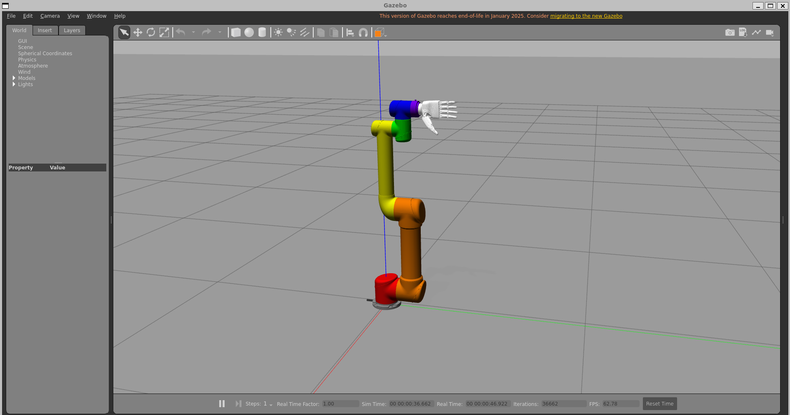
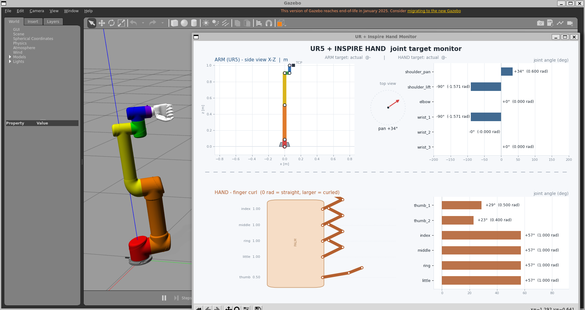

# ur_inspire_hand — 优傲机械臂 + 因时灵巧手 组合仿真工程

## 一.概述：
把 **优傲（Universal Robots）UR 系列机械臂** 和 **因时机器人（Inspire Robots）RH56DFX 仿人五指灵巧手** 组装成一个"肩—臂—肘—腕—手"的完整机械臂，并在 **ROS 2 Humble + Gazebo Classic 11** 中一键启动，可通过 `ros2_control` 控制器同时驱动手臂和手指。

## 二、主体命令：
### 1. 启动机械臂仿真：
```
ros2 launch ur_inspire_hand ur_inspire_gazebo.launch.py
```

### 2.启动数据监视器：
```
ros2 run ur_inspire_hand hand_arm_monitor.py
```

### 3.灵巧手常规命令：
```
ros2 run ur_inspire_hand hand_preset.py hand open      # 全部张开
ros2 run ur_inspire_hand hand_preset.py hand first     # 握拳
ros2 run ur_inspire_hand hand_preset.py hand pinch     # 拇指食指捏合
ros2 run ur_inspire_hand hand_preset.py hand point     # 食指伸出指点
ros2 run ur_inspire_hand hand_preset.py hand ok        # OK 手势
ros2 run ur_inspire_hand hand_preset.py hand first 1.0  # 指定 1 秒完成
```
自定义灵巧手姿态，七个数字分别对应关节right_thumb_1_joint, right_thumb_2_joint, right_index_1_joint, right_middle_1_joint, right_ring_1_joint, right_little_1_joint + 一个完成时长：
```
ros2 run ur_inspire_hand hand_preset.py hand custom 0.5 0.4 1.0 1.0 1.0 1.0 3.0
```

### 4.机械臂常规命令：
```
ros2 run ur_inspire_hand hand_preset.py arm home   # 回 home 位 (与仿真启动一致)
ros2 run ur_inspire_hand hand_preset.py arm ready  # 工作准备位 (shoulder_pan=0.6)
```
自定义机械臂姿态，七个数字分别对应关节shoulder_pan_joint, shoulder_lift_joint, elbow_joint, wrist_1_joint, wrist_2_joint, wrist_3_joint + 一个完成时长：
```
ros2 run ur_inspire_hand hand_preset.py arm custom 0.6 -1.5708 0 -1.5708 0 0 3.0
```
---

## 二. 资源来源（官网核查结论）

| 部件 | 官方渠道 | 结论 |
|---|---|---|
| UR 机械臂 | 官网文档指向 GitHub 官方仓库 [`Universal_Robots_ROS2_Description`](https://github.com/UniversalRobots/Universal_Robots_ROS2_Description)（本工程用 `humble` 分支，位于 `src/Universal_Robots_ROS2_Description/`） | **URDF/xacro 就在 GitHub 官方仓库下载** |
| 因时 RH56DFX 灵巧手 | 因时官网（inspire-robots.com）仅提供 **STEP CAD 模型**（RAR 打包，右/左手各一份，已下载至 `downloads/inspire_hand_*.rar` 并解压）；官网 GitHub 组织为空 | **官网没有现成 URDF**；本工程使用的 URDF 来自社区镜像（NYU `inspire-sdk`，位于 `inspire-sdk/`，仅作参考），网格模型源自官方 CAD |

> 机械臂和灵巧手拼接是：把因时灵巧手的安装板（`inspire_hand_base`）用一个固定 joint 直接装到 `tool0` 上。

## 三. 人体结构比喻（运动链映射）

```
world
 └─ base_link                     底座
     ├─ shoulder_pan_joint        肩（绕基座旋转）
     ├─ shoulder_lift_joint       肩（抬臂）
     ├─ elbow_joint               肘
     ├─ wrist_1/2/3_joint         腕（三轴）
     │   └─ tool0                 腕法兰
     │       └─ inspire_hand_base 手掌（因时 RH56DFX 右手）
     │           ├─ thumb_1/2_joint        拇指（2 主动关节）
     │           ├─ index_1_joint          食指
     │           ├─ middle_1_joint         中指
     │           ├─ ring_1_joint           无名指
     │           └─ little_1_joint         小指
     └─ （每根手指第 2 节为 mimic 从动关节，自动跟随第 1 节）
```

## 四. 相关依赖：
`ros-humble-gazebo-ros2-control`、`ros-humble-ros2-controllers`、
`ros-humble-joint-state-publisher-gui`、`ros-humble-ros2controlcli`、`ros-humble-tf2-ros`。

## 五.运行效果：


